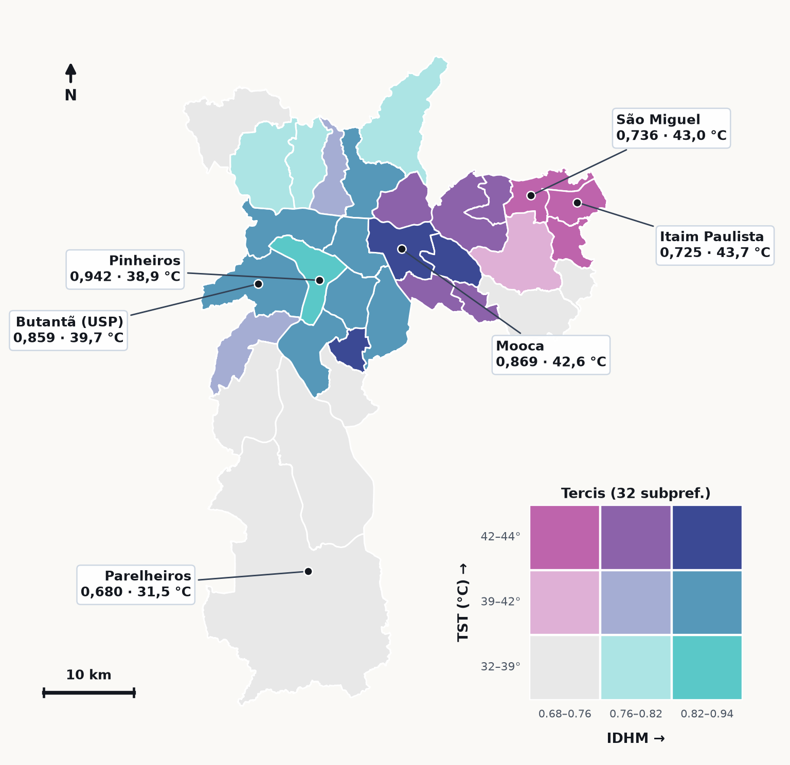
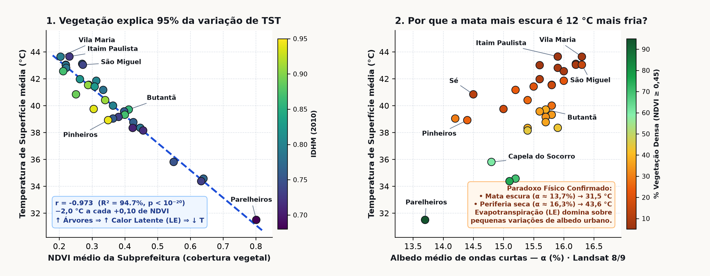
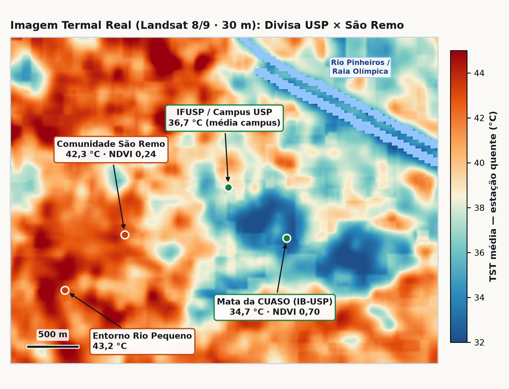

# Aula Expositiva: Desigualdade Térmica na Cidade de São Paulo

> **Disciplina:** Física do Meio Ambiente — Instituto de Física da USP (IFUSP)  
> **Tema:** Ilhas de calor urbanas, física do balanço energético e contraste socioambiental  
> **Formato:** Material expositivo conceitual (acompanha os [slides em PDF](slides/Aula_Expositiva_Desigualdade_Termica_SP.pdf) e [PPTX](slides/Aula_Expositiva_Desigualdade_Termica_SP.pptx))

---

## Sumário

- [Módulo I — Fenômeno das Ilhas de Calor e Contexto Socioespacial](#módulo-i--fenômeno-das-ilhas-de-calor-e-contexto-socioespacial)
  - [1.1. Mesma Cidade, Climas Opostos](#11-mesma-cidade-climas-opostos)
  - [1.2. Impactos do Calor Extremo no Ambiente Urbano](#12-impactos-do-calor-extremo-no-ambiente-urbano)
  - [1.3. Distribuição Espacial: Temperatura de Superfície (TST) × IDHM](#13-distribuição-espacial-temperatura-de-superfície-tst--idhm)
  - [1.4. Determinantes Microclimáticos e Déficit Estrutural de Vegetação](#14-determinantes-microclimáticos-e-déficit-estrutural-de-vegetação)
- [Módulo II — Fundamentos Físicos do Balanço Energético Urbano](#módulo-ii--fundamentos-físicos-do-balanço-energético-urbano)
  - [2.1. Formação das Ilhas de Calor Urbanas](#21-formação-das-ilhas-de-calor-urbanas)
  - [2.2. Calor Sensível, Calor Latente e Inércia Térmica](#22-calor-sensível-calor-latente-e-inércia-térmica)
  - [2.3. Mecanismos de Transferência de Calor na Cidade](#23-mecanismos-de-transferência-de-calor-na-cidade)
  - [2.4. Albedo Superficial e Temperatura de Superfície (TST)](#24-albedo-superficial-e-temperatura-de-superfície-tst)
  - [2.5. Balanço de Energia na Superfície e Razão de Bowen](#25-balanço-de-energia-na-superfície-e-razão-de-bowen)
  - [2.6. O Papel Físico da Vegetação Urbana](#26-o-papel-físico-da-vegetação-urbana)
  - [2.7. Evidência Empírica (Landsat 8/9) e o Paradoxo do Albedo](#27-evidência-empírica-landsat-89-e-o-paradoxo-do-albedo)
- [Módulo III — Estudo de Caso em Microescala e Física da Mitigação Urbana](#módulo-iii--estudo-de-caso-em-microescala-e-física-da-mitigação-urbana)
  - [3.1. Cidade Universitária da USP: Um Laboratório Natural](#31-cidade-universitária-da-usp-um-laboratório-natural)
  - [3.2. Contraste Imediato na Divisa: Campus USP × Comunidade São Remo](#32-contraste-imediato-na-divisa-campus-usp--comunidade-são-remo)
  - [3.3. Soluções de Mitigação e Atuação no Balanço Energético](#33-soluções-de-mitigação-e-atuação-no-balanço-energético)
  - [3.4. Síntese Conceitual](#34-síntese-conceitual)
- [Nota Metodológica (Dados Orbitais e Socioespaciais)](#nota-metodológica-dados-orbitais-e-socioespaciais)
- [Referências Bibliográficas](#referências-bibliográficas)

---

## Módulo I — Fenômeno das Ilhas de Calor e Contexto Socioespacial

### 1.1. Mesma Cidade, Climas Opostos

As **Ilhas de Calor Urbanas (ICUs)** correspondem ao fenômeno físico caracterizado pela ocorrência de temperaturas significativamente mais elevadas em áreas densamente urbanizadas e impermeabilizadas quando comparadas a regiões menos construídas, periurbanas ou com ampla cobertura vegetal (BARROS; LOMBARDO, 2016).

No município de São Paulo, embora diferentes regiões estejam situadas praticamente na mesma latitude e recebam a mesma radiação solar incidente no topo da atmosfera, a temperatura superficial e do ar varia de forma acentuada entre bairros. Em monitoramento microclimático realizado por Reis e Galvani (2025), registrou-se uma **diferença térmica máxima de até 8,8 °C no verão** (e de até **7,9 °C no inverno**) entre o **Jardim Paulista** (Zona Oeste) e a **Vila Jacuí** (Zona Leste).

Essa amplitude dentro de um único município equivale à diferença climática média entre cidades separadas por centenas de quilômetros, evidenciando que a configuração física da superfície urbana atua diretamente como moduladora do microclima.

| Dimensão | Jardim Paulista (Subpref. Pinheiros) | Vila Jacuí (Subpref. São Miguel Paulista) |
| :--- | :--- | :--- |
| **IDHM (Subprefeitura)** | `0,942` | `0,736` |
| **TST média (Landsat 8/9)** | `37,6 °C` | `43,5 °C` (percentil 90: `45,1 °C`) |
| **NDVI médio** | `0,333` | `0,242` |
| **Vegetação densa** | `21,6%` | `9,1%` |
| **Perfil urbano** | Copas contínuas, parques, jardins e recuos amplos | Alta densidade construtiva, solo impermeável e pouca arborização |

> **Nota conceitual:** O valor de `8,8 °C` representa a diferença microclimática máxima registrada entre pontos monitorados no verão, enquanto a diferença de `+5,9 °C` (`37,6 °C` vs. `43,5 °C`) corresponde à média espacial multitemporal da Temperatura de Superfície Terrestre (TST) obtida via satélite.

---

### 1.2. Impactos do Calor Extremo no Ambiente Urbano

A heterogeneidade térmica intra-urbana produz consequências diretas sobre a saúde pública, o consumo energético e a habitabilidade:

- **Estresse térmico:** sobrecarga cardiovascular e respiratória, especialmente em idosos, crianças e trabalhadores expostos ao ar livre.
- **Noites mais quentes:** a liberação lenta do calor estocado no concreto e no asfalto reduz o resfriamento noturno e prejudica a qualidade do sono.
- **Maior demanda energética:** elevação do gasto domiciliar com ventilação mecânica e climatização elétrica.
- **Vulnerabilidade habitacional:** edificações com telhas finas de fibrocimento ou metal, sem laje ou forro isolante, amplificam a transferência de calor para o interior das residências.

---

### 1.3. Distribuição Espacial: Temperatura de Superfície (TST) × IDHM

O cruzamento da Temperatura de Superfície Terrestre (TST média na estação quente, 2023–2026, Landsat 8/9) com o Índice de Desenvolvimento Humano Municipal (IDHM 2010, SMUL/PNUD) nas **32 subprefeituras de São Paulo** revela que a desigualdade térmica se organiza em **três regimes socioambientais distintos**:



1. **Bordas florestais e mananciais (baixo IDHM + baixa TST):** subprefeituras periféricas que preservam extensas Áreas de Proteção Ambiental — como **Parelheiros** (`31,5 °C`; IDHM `0,680`), **Perus** (`34,4 °C`; IDHM `0,731`) e **Capela do Socorro** (`35,8 °C`; IDHM `0,750`) — apresentam médias térmicas mais baixas devido à Mata Atlântica e aos mananciais, embora seus núcleos densamente construídos permaneçam quentes.
2. **Periferia urbana adensada (baixo IDHM + alta TST — risco crítico):** territórios da Zona Leste como **Itaim Paulista** (`43,7 °C`; IDHM `0,725`), **São Miguel Paulista / Vila Jacuí** (`43,0–43,5 °C`; IDHM `0,736`), **Ermelino Matarazzo** (`43,1 °C`; IDHM `0,777`) e **Sapopemba** (`43,0 °C`; IDHM `0,785`) combinam déficit severo de vegetação, alta impermeabilização e picos térmicos extremos.
3. **Centro expandido arborizado vs. eixos industriais (alto IDHM):** bairros planejados e arborizados como **Pinheiros** (`38,9 °C`; IDHM `0,942`) e **Butantã / USP** (`39,7 °C`; IDHM `0,859`) mantêm temperaturas mais amenas; já regiões de IDHM médio-alto com histórico industrial e logístico, como **Mooca** (`42,6 °C`; IDHM `0,869`) e **Vila Maria / Vila Guilherme** (`43,6 °C`; IDHM `0,793`), aquecem intensamente pela impermeabilização quase total do solo.

| Região / Recorte | TST Média (°C) | NDVI Médio | Vegetação Densa (%) | IDHM* | Regime Socioambiental |
| :--- | :---: | :---: | :---: | :---: | :--- |
| **Itaim Paulista (ZL)** | `43,7 °C` | `0,231` | `6,5%` | `0,725` | Periferia densa · risco crítico |
| **Vila Maria / V. Guilherme (ZN)** | `43,6 °C` | `0,204` | `7,0%` | `0,793` | Eixo logístico e industrial |
| **Vila Jacuí (São Miguel · ZL)** | `43,5 °C` | `0,242` | `9,1%` | `0,736` | Periferia densa · pouca copa |
| **Mooca (Centro-Leste)** | `42,6 °C` | `0,212` | `8,1%` | `0,869` | Alto IDHM · alta impermeabilização |
| **Butantã · Campus USP (ZO)** | `39,2 °C` | `0,452` | `45,3%` | `0,859` | Oásis arbóreo no campus (`36,7 °C` interno) |
| **Jardim Paulista (Pinheiros · ZO)** | `37,6 °C` | `0,333` | `21,6%` | `0,942` | Alto IDHM · bairros-jardim |
| **Parelheiros (Sul)** | `31,5 °C` | `0,801` | `96,4%` | `0,680` | Borda florestal · APA Mata Atlântica |

*\*IDHM referente à subprefeitura correspondente.*

---

### 1.4. Determinantes Microclimáticos e Déficit Estrutural de Vegetação

Quatro variáveis físicas de ocupação do solo governam a formação dos microclimas urbanos:

1. **Arborização:** controla o sombreamento direto e a taxa de evapotranspiração.
2. **Impermeabilização do solo:** asfalto e concreto bloqueiam a infiltração de água, reduzindo a umidade superficial disponível.
3. **Densidade construtiva:** edificações muito próximas reduzem o escoamento de ventos e aprisionam radiação de ondas longas entre fachadas (*efeito cânion urbano*).
4. **Propriedades dos materiais:** superfícies escuras e densas elevam a absorção solar e o armazenamento térmico.

A distribuição desigual dessas características no espaço urbano decorre de fatores históricos e socioeconômicos: **urbanização desigual** (planejamento concentrado em bairros centrais), **especulação imobiliária** (áreas verdes valorizam o solo urbano), **aproveitamento máximo do lote** (autoconstrução sem recuos ou quintais permeáveis) e **infraestrutura restrita** (calçadas estreitas, fiação baixa e menor investimento público contínuo).

---

## Módulo II — Fundamentos Físicos do Balanço Energético Urbano

### 2.1. Formação das Ilhas de Calor Urbanas

O aquecimento urbano segue um ciclo energético contínuo em quatro etapas:

```text
1. Radiação Solar (ondas curtas)
        │
        ▼
2. Absorção Urbana (asfalto, concreto e telhados escuros)
        │
        ▼
3. Retenção Térmica (estoque de energia interna e calor sensível)
        │
        ▼
4. Emissão Noturna (radiação infravermelha aquece o ar urbano)
```

Durante o dia, superfícies construídas absorvem grande parcela da radiação solar incidente. Parte dessa energia aquece diretamente o ar por convecção, enquanto outra parcela é armazenada nas massas de concreto e alvenaria e liberada lentamente na forma de radiação infravermelha durante a noite.

---

### 2.2. Calor Sensível, Calor Latente e Inércia Térmica

A resposta térmica dos materiais urbanos depende de duas equações fundamentais da termodinâmica:

$$Q = m \cdot c \cdot \Delta T \qquad \text{e} \qquad Q = m \cdot L_v$$

Onde:
- $Q$ é a quantidade de calor transferida ou absorvida ($\text{J}$);
- $m$ é a massa do material ou da água ($\text{kg}$);
- $c$ é o **calor específico** ($\text{J}\cdot\text{kg}^{-1}\cdot\text{K}^{-1}$);
- $\Delta T$ é a variação de temperatura ($\text{°C}$ ou $\text{K}$);
- $L_v \approx 2{,}45 \times 10^6\ \text{J/kg}$ é o **calor latente de vaporização da água**.

**Implicações no meio urbano:**
- **Concreto e asfalto (domínio do calor sensível):** apresentam calor específico relativamente baixo ($c \approx 0{,}9\ \text{kJ}\cdot\text{kg}^{-1}\cdot\text{K}^{-1}$) e ausência de água livre. Assim, a energia absorvida converte-se diretamente em aumento de temperatura ($\Delta T$). Além disso, grandes massas construídas possuem elevada **capacidade térmica** ($C = m \cdot c$) e alta **inércia térmica**, acumulando calor durante o dia e retardando o resfriamento noturno.
- **Água e vegetação (domínio do calor latente):** a água possui elevado calor específico ($c \approx 4{,}18\ \text{kJ}\cdot\text{kg}^{-1}\cdot\text{K}^{-1}$) e altíssimo calor latente de vaporização. Quando há umidade no solo e transpiração vegetal, grande parte da radiação incidente é consumida na mudança de fase líquida → vapor, sem elevar a temperatura do ar.

---

### 2.3. Mecanismos de Transferência de Calor na Cidade

A redistribuição da energia térmica na malha urbana ocorre simultaneamente por três mecanismos físicos:

1. **Condução:** transferência de energia térmica por contato direto no interior de meios sólidos — por exemplo, a propagação do calor da superfície externa do asfalto e das lajes de concreto para o interior das edificações e para o subsolo.
2. **Convecção:** transporte de energia pelo escoamento do ar aquecido em contato com as superfícies urbanas. Em bairros muito adensados e com vias estreitas, a rugosidade aerodinâmica reduz a velocidade do vento e dificulta a dissipação convectiva do calor.
3. **Radiação Infravermelha:** emissão de ondas eletromagnéticas na faixa do infravermelho termal ($8\text{–}14\ \mu\text{m}$) pelas superfícies aquecidas. Essa emissão reaquece as camadas inferiores da atmosfera urbana e constitui o sinal físico captado pelos sensores orbitais termais (como a banda 10 do Landsat 8/9).

---

### 2.4. Albedo Superficial e Temperatura de Superfície (TST)

Ao incidir sobre uma superfície, uma fração $\alpha$ da radiação solar de ondas curtas — chamada de **albedo superficial** — é refletida, enquanto a fração complementar $(1 - \alpha)$ é absorvida:

$$\alpha = \frac{I_{\text{refletida}}}{I_{\text{incidente}}}, \qquad 0 \le \alpha \le 1$$

| Tipo de Superfície | Albedo Típico ($\alpha$) | Comportamento Radiativo Predominante |
| :--- | :---: | :--- |
| **Asfalto novo / escuro** | `5% – 10%` | Absorve `90–95%` da radiação; aquecimento rápido |
| **Telhado escuro / fibrocimento envelhecido** | `10% – 15%` | Alta absorção; eleva carga térmica interna |
| **Vegetação urbana / floresta densa** | `15% – 25%` | Absorção moderada, compensada por sombra e evapotranspiração |
| **Concreto claro / pavimento cimentício** | `20% – 30%` | Reflexão intermediária; elevada inércia térmica |
| **Telhado frio / tinta refletiva (*Cool Roof*)** | `65% – 80%` | Reflete a maior parte da radiação solar incidente |

> **TST vs. Temperatura do Ar:** Imagens de satélite medem a **Temperatura de Superfície Terrestre (TST)** — temperatura radiativa direta de telhados, pavimentos e copas —, que em períodos ensolarados é fisicamente superior à temperatura do ar medida em abrigos meteorológicos (NASCIMENTO et al., 2022).

---

### 2.5. Balanço de Energia na Superfície e Razão de Bowen

A partição da energia radiativa líquida absorvida por uma superfície urbana ($R_n$) é descrita pela **equação do balanço de energia**:

$$R_n = H + LE + G$$

Onde:
- $R_n$: saldo de radiação líquida (ondas curtas absorvidas + balanço de ondas longas);
- $H$: fluxo de **calor sensível** transferido para a atmosfera (aquece diretamente o ar);
- $LE$: fluxo de **calor latente** consumido na evaporação de água do solo e na transpiração vegetal;
- $G$: fluxo de **calor armazenado** no solo, concreto, asfalto e estruturas construídas.

Um indicador adimensional central da Física Ambiental é a **Razão de Bowen**:

$$\beta = \frac{H}{LE}$$

| Tipo de Superfície Urbana | Calor Sensível ($H$) | Armazenamento ($G$) | Calor Latente ($LE$) | Razão de Bowen ($\beta$) |
| :--- | :---: | :---: | :---: | :---: |
| **Impermeável e adensada** *(ex.: Vila Jacuí)* | `~55%` | `~35%` | `~10%` | **Elevada** ($\beta \gg 1$) |
| **Arborizada e permeável** *(ex.: Jardim Paulista / USP)* | `~25%` | `~15%` | `~60%` | **Reduzida** ($\beta < 1$) |

---

### 2.6. O Papel Físico da Vegetação Urbana

A vegetação urbana atua simultaneamente em três frentes físicas:

1. **Sombreamento direto:** as copas interceptam a radiação solar de ondas curtas antes que ela atinja pavimentos e fachadas, reduzindo o aquecimento superficial e o termo $G$.
2. **Evapotranspiração:** a transpiração foliar converte energia térmica em calor latente ($LE$), reduzindo a razão de Bowen ($\beta$) e promovendo resfriamento efetivo do microclima (GRACE et al., 2025).
3. **Qualidade do ar e umidade:** as folhas retêm material particulado atmosférico e elevam a umidade relativa local.

---

### 2.7. Evidência Empírica (Landsat 8/9) e o Paradoxo do Albedo

O cruzamento dos dados orbitais reais de TST, **Índice de Vegetação por Diferença Normalizada (NDVI)** e albedo de ondas curtas (LIANG, 2001) para todas as **32 subprefeituras de São Paulo** demonstra empiricamente duas leis físicas fundamentais:



1. **Domínio da cobertura vegetal (Painel 1):** há uma correlação linear negativa extremamente forte entre vegetação (NDVI) e temperatura de superfície:
   $$r = -0{,}973, \qquad R^2 = 94{,}7\%, \qquad p < 10^{-20}$$
   Quase **95% da variação espacial de temperatura** entre as subprefeituras paulistanas é explicada pela presença de vegetação, com redução média de aproximadamente **$-2{,}0\ \text{°C}$ a cada incremento de $+0{,}10$ no NDVI**.

2. **Resolução empírica do Paradoxo do Albedo (Painel 2):** subprefeituras cobertas por Mata Atlântica densa, como **Parelheiros**, apresentam albedo médio *menor* ($\alpha \approx 13{,}7\%$, absorvendo $\sim 86\%$ da radiação solar) do que periferias densamente construídas como **Itaim Paulista** e **São Miguel** ($\alpha \approx 15{,}9\text{–}16{,}3\%$). Apesar disso, Parelheiros é cerca de **12 °C mais fria** (`31,5 °C` contra `43,7 °C`).  
   **Explicação física:** na escala urbana, o resfriamento por calor latente ($LE$) e sombreamento das árvores domina amplamente sobre pequenas diferenças de albedo entre materiais convencionais. O aumento de albedo só produz resfriamento expressivo isoladamente quando elevado a patamares de telhados frios altamente refletivos ($\alpha \approx 65\text{–}80\%$).

---

## Módulo III — Estudo de Caso em Microescala e Física da Mitigação Urbana

### 3.1. Cidade Universitária da USP: Um Laboratório Natural

A **Cidade Universitária da USP**, no distrito do Butantã, constitui um laboratório natural para observar a física das ilhas de frescor urbanas (BUENO; XIMENES, 2011; RODRIGUES et al., 2025):

- **Ilha de frescor:** grandes maciços arbóreos e remanescentes de Mata Atlântica (como a Mata da CUASO) mantêm temperaturas substancialmente inferiores às do entorno metropolitano.
- **Solo permeável:** bosques, praças e gramados favorecem a infiltração hídrica e sustentam fluxos elevados de evapotranspiração ($LE$).
- **Heterogeneidade interna:** mesmo dentro do campus, setores amplamente pavimentados e expostos (como trechos da Praça do Relógio) aquecem mais do que setores sombreados, confirmando a sensibilidade local à cobertura do solo.

---

### 3.2. Contraste Imediato na Divisa: Campus USP × Comunidade São Remo

O recorte termal de alta resolução (`30 m`, Landsat 8/9) sobre a divisa oeste do campus demonstra que a desigualdade térmica se manifesta em escalas de poucas centenas de metros:



| Setor Monitorado | TST Média | NDVI | Características Físicas |
| :--- | :---: | :---: | :--- |
| **Mata da CUASO (IB-USP)** | `34,7 °C` | `0,70` | Dossel florestal denso e solo permeável |
| **Campus USP / IFUSP** | `36,7 °C` | `0,45` | Corredores arbóreos e edificações espaçadas |
| **Comunidade São Remo** | `42,3 °C` | `0,24` | Ocupação densa, telhados contíguos e solo impermeável |
| **Entorno Rio Pequeno** | `43,2 °C` | `0,21` | Malha urbana altamente pavimentada |

Ao cruzar o limite entre o campus e a comunidade adjacente, observa-se um **salto térmico de $+5{,}6\ \text{°C}$ a $+7{,}6\ \text{°C}$ em cerca de 500 metros**, confirmando que o uso e a cobertura do solo produzem microclimas opostos lado a lado.

---

### 3.3. Soluções de Mitigação e Atuação no Balanço Energético

A mitigação das ilhas de calor urbanas baseia-se em intervenções que alteram deliberadamente os termos da equação $R_n = H + LE + G$:

| Intervenção Urbana | Mecanismo Físico Predominante | Efeito no Balanço Energético | Horizonte |
| :--- | :--- | :--- | :---: |
| **Telhados Refletivos (*Cool Roofs*)** | Aumento do albedo ($\alpha \to 65\text{–}80\%$) | Reduz radiação absorvida ($\downarrow R_n$) | Curto prazo |
| **Arborização Viária e Microflorestas** | Sombreamento direto + evapotranspiração | Eleva calor latente ($\uparrow LE$; $\approx -2{,}0\ \text{°C}$ / $+0{,}10$ NDVI) | Médio prazo |
| **Telhados Verdes e Solo Permeável** | Inércia térmica + retenção hídrica | Reduz fluxo de calor interno ($\downarrow G$) e eleva $LE$ | Médio prazo |
| **Parques Periféricos e Corredores Verdes** | Efeito ilha de frescor + ventilação convectiva | Reduz $H$ e alivia picos térmicos em escala de bairro | Longo prazo |

**Critério técnico de priorização territorial:** o cruzamento do mapa térmico (TST) com o IDHM indica que intervenções imediatas — combinando telhados refletivos no curto prazo com corredores arbóreos e parques no médio e longo prazo — produzem maior retorno social e climático quando concentradas no quadrante crítico de menor IDHM e maior temperatura (como Itaim Paulista, São Miguel Paulista, Ermelino Matarazzo, Sapopemba e comunidades como a São Remo).

---

### 3.4. Síntese Conceitual

1. **Contraste térmico metropolitano:** São Paulo apresenta diferenças microclimáticas de até **8,8 °C** entre bairros com padrões opostos de ocupação e cobertura vegetal.
2. **Física do balanço de energia:** A substituição de solo permeável e vegetação por asfalto e concreto desloca $R_n = H + LE + G$ para o aquecimento sensível ($H$) e o armazenamento térmico ($G$), elevando a razão de Bowen ($\beta$).
3. **Domínio da infraestrutura verde:** A correlação $r = -0{,}973$ ($R^2 = 94{,}7\%$) entre NDVI e TST, o Paradoxo do Albedo e o contraste USP × São Remo comprovam o papel dominante da vegetação e da evapotranspiração na regulação climática urbana.
4. **Justiça socioambiental:** Combater as ilhas de calor integra Física Ambiental, saúde pública, eficiência energética e direito à cidade.

---

## Nota Metodológica (Dados Orbitais e Socioespaciais)

Os resultados quantitativos próprios incorporados nesta aula foram obtidos a partir de:
- **Processamento orbital (Landsat 8/9 Collection 2 Level-2):** composta mediana pixel a pixel (`30 m`) de **6 cenas de estação quente** (primavera/verão, 2023–2026, cobertura de nuvens `< 5%`, órbita/ponto WRS `219/076`) obtidas via *Microsoft Planetary Computer STAC API*, com máscara `QA_PIXEL` para remoção de nuvens, sombras, cirros e corpos d'água abertos.
- **Conversões físicas:**
  - Temperatura de superfície: $\text{TST}[\text{°C}] = 0{,}00341802 \cdot \text{ST\_B10} + 149{,}0 - 273{,}15$ (fatores oficiais USGS).
  - Índice de vegetação: $\text{NDVI} = \frac{\text{NIR} - \text{RED}}{\text{NIR} + \text{RED}}$.
  - Albedo de ondas curtas: conversão banda-estreita para banda-larga segundo Liang (2001).
- **Integração socioespacial:** médias zonais para as 32 subprefeituras e 96 distritos (malhas GeoSampa, projeção `EPSG:31983` — SIRGAS 2000 / UTM 23S) cruzadas com o IDHM 2010 oficial (SMUL/PNUD). Os dados tabulares e scripts de análise estão disponíveis em [`dados/`](dados/) e [`scripts/`](scripts/).

---

## Referências Bibliográficas

- **BARROS, H. R.; LOMBARDO, M. A.** A ilha de calor urbana e o uso e cobertura do solo em São Paulo-SP. *GEOUSP Espaço e Tempo*, v. 20, n. 1, p. 71–82, 2016.
- **BUENO, E. S.; XIMENES, D. S. S.** A importância da infraestrutura verde no desenho ambiental: estudo da área da Cidade Universitária e Instituto Butantã. *Revista LABVERDE*, n. 3, p. 128–154, 2011. DOI: `10.11606/issn.2179-2275.v0i3p128-154`.
- **GRACE, B.; BOLLETER, J.; BARGHCHI, M.; LUND, J.** Unpacking park cool island effects using remote-sensed, measured and modelled microclimatic data. *Land*, v. 14, n. 8, art. 1686, 2025. DOI: `10.3390/land14081686`.
- **IAG-USP.** Laboratório de Micrometeorologia — Plataforma Micrometeorológica da Cidade Universitária. São Paulo: Universidade de São Paulo.
- **LIANG, S.** Narrowband to broadband conversions of land surface albedo I: Algorithms. *Remote Sensing of Environment*, v. 76, n. 2, p. 213–238, 2001. DOI: `10.1016/S0034-4257(00)00205-4`.
- **MICROSOFT PLANETARY COMPUTER; USGS.** *Landsat Collection 2 Level-2 Science Products (Landsat 8/9 OLI-TIRS, WRS 219/076, 2023–2026)*.
- **NASCIMENTO, A. C. L. do; GALVANI, E.; GOBO, J. P. A.; WOLLMANN, C. A.** Comparison between air temperature and land surface temperature for the city of São Paulo, Brazil. *Atmosphere*, v. 13, n. 3, art. 491, 2022. DOI: `10.3390/atmos13030491`.
- **REIS, F. R.; GALVANI, E.** Desigualdade socioespacial e térmica: estudo de caso da subprefeitura de São Miguel Paulista e Pinheiros – São Paulo (SP). *Revista da ANPEGE*, v. 21, n. 44, 2025. DOI: `10.5418/ra2025.v21i44.19759`.
- **RODRIGUES, S. I.; PINTO DA ROCHA, R.; CECCANTINI, G. C. T.** Analysis of microclimates in the USP Butantã campus and surroundings: impact of vegetation and urbanizations. *Revista da Sociedade Brasileira de Arborização Urbana*, v. 20, 2025. DOI: `10.5380/revsbau.v20.100028`.
- **SÃO PAULO (Município). SMUL; PNUD.** *Índice de Desenvolvimento Humano Municipal (IDHM) por Subprefeitura — Censo 2010 e Malhas Digitais GeoSampa*. São Paulo: PMSP.
