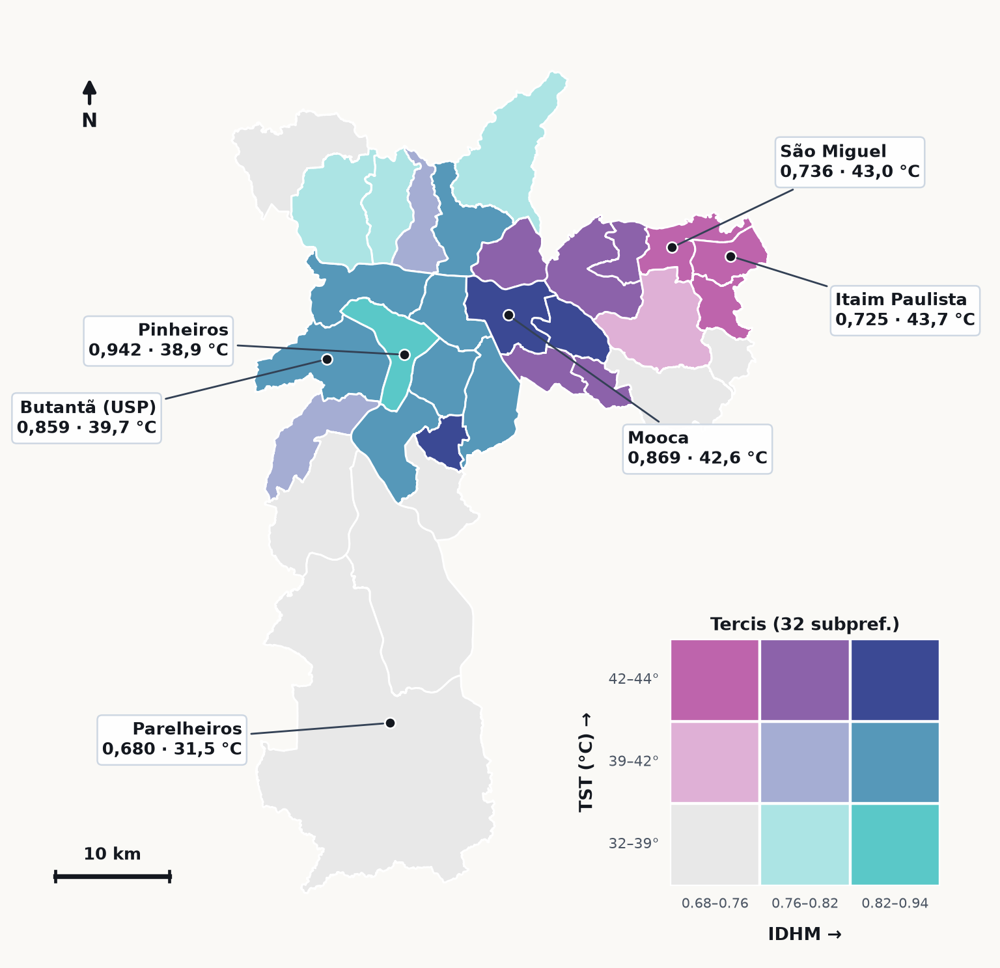
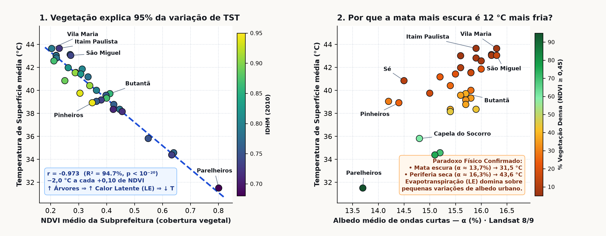

# Desigualdade Térmica na Cidade de São Paulo — Aula Expositiva (IFUSP)


Material completo de **aula expositiva conceitual** (sem exercícios ou dinâmicas de grupo) sobre **ilhas de calor urbanas, física do balanço energético e desigualdade socioambiental** na cidade de São Paulo, desenvolvido no contexto da disciplina de **Física do Meio Ambiente (Instituto de Física da USP)**.

---

## Acesso Rápido aos Materiais

| Recurso | Descrição | Link |
| :--- | :--- | :--- |
| **Texto da Aula (Markdown)** | Aula expositiva completa com equações em LaTeX, tabelas, figuras e referências | [AULA_EXPOSITIVA.md](AULA_EXPOSITIVA.md) |
| **Slides (PDF Vetorial)** | Apresentação editorial 16:9 com 20 slides conceituais em 3 módulos | [Aula_Expositiva_Desigualdade_Termica_SP.pdf](slides/Aula_Expositiva_Desigualdade_Termica_SP.pdf) |
| **Slides (PPTX 2x Retina)** | Versão PowerPoint em alta nitidez (`2560×1440`) | [Aula_Expositiva_Desigualdade_Termica_SP.pptx](slides/Aula_Expositiva_Desigualdade_Termica_SP.pptx) |
| **Código-fonte dos Slides** | HTML/CSS editorial + pipeline Python (`Playwright` + `python-pptx`) | [slides/slides.html](slides/slides.html) |
| **Dados Tabulares** | Médias zonais de TST, NDVI, albedo e IDHM por subprefeitura e distrito | [dados/](dados/) |
| **Scripts de Análise** | Código Python de extração Landsat 8/9, regressão física e mapas | [scripts/](scripts/) |

---

## Estrutura Conceitual da Aula

A aula está organizada em **três módulos conceituais**:

1. **Módulo I — Fenômeno e Contexto Socioespacial:** ilhas de calor urbanas, contraste de até `8,8 °C` entre Jardim Paulista e Vila Jacuí, impactos sobre saúde e energia, mapa bivariado `TST × IDHM` nas 32 subprefeituras e fatores estruturais do déficit de vegetação.
2. **Módulo II — Fundamentos Físicos:** ciclo diurno/noturno das ilhas de calor, calor sensível ($Q = m \cdot c \cdot \Delta T$) e latente ($Q = m \cdot L_v$), condução/convecção/radiação infravermelha, albedo superficial ($\alpha$), balanço energético ($R_n = H + LE + G$), razão de Bowen ($\beta = H/LE$), evidência empírica (`NDVI × TST`) e o **Paradoxo do Albedo**.
3. **Módulo III — Estudo de Caso e Mitigação:** Cidade Universitária da USP como ilha de frescor, contraste imediato na divisa `Campus USP × Comunidade São Remo` (`+7,6 °C` em 500 m) e física aplicada das soluções urbanas de mitigação.

---

## Principais Evidências Empíricas

<p align="center">
  
  
</p>

- **Contraste microclimático extremo:** até `8,8 °C` no verão (`7,9 °C` no inverno) entre Jardim Paulista e Vila Jacuí (Reis & Galvani, 2025), corroborado por `+5,9 °C` de diferença média espacial via Landsat 8/9 (`37,6 °C` vs. `43,5 °C`).
- **Domínio da vegetação (32 subprefeituras):** correlação linear de $r = -0{,}973$ ($R^2 = 94{,}7\%$, $p < 10^{-20}$) entre NDVI e TST, com redução média de $\approx -2{,}0\ \text{°C}$ a cada $+0{,}10$ de NDVI.
- **Paradoxo do Albedo confirmado:** Mata Atlântica em Parelheiros ($\alpha \approx 13{,}7\%$, `31,5 °C`) é `~12 °C` mais fria do que periferias impermeabilizadas ($\alpha \approx 16{,}3\%$, `43,6 °C`), demonstrando o domínio do calor latente ($LE$).
- **Contraste em microescala (500 m):** salto térmico de `34,7 °C` (Mata da CUASO / USP) e `36,7 °C` (Campus USP) para `42,3 °C` na Comunidade São Remo (`+5,6 °C` a `+7,6 °C`).

---

## Estrutura do Repositório

```text
.
├── README.md                                           # Visão geral e índice do repositório
├── AULA_EXPOSITIVA.md                                  # Aula expositiva completa em Markdown
├── slides/
│   ├── slides.html                                     # Fonte HTML/CSS dos 20 slides
│   ├── build_from_html.py                              # Gerador PDF vetorial + PPTX 2x Retina
│   ├── requirements.txt                                # Dependências do build de slides
│   ├── assets/                                         # Figuras integradas aos slides
│   ├── Aula_Expositiva_Desigualdade_Termica_SP.pdf     # Apresentação final (PDF)
│   └── Aula_Expositiva_Desigualdade_Termica_SP.pptx    # Apresentação final (PPTX)
├── figuras/                                            # Figuras científicas em alta resolução
├── dados/                                              # Tabelas CSV (32 subprefeituras e 96 distritos) + metadados Landsat
└── scripts/                                            # Scripts Python da análise Landsat 8/9 e geração de gráficos
```

---

## Como Recompilar os Slides

```bash
cd slides
python3 -m venv .venv
.venv/bin/pip install -r requirements.txt
.venv/bin/playwright install chromium
.venv/bin/python build_from_html.py
```

O comando gera `Aula_Expositiva_Desigualdade_Termica_SP.pdf` (vetorial) e `Aula_Expositiva_Desigualdade_Termica_SP.pptx` (`2560×1440` em formato 16:9).
